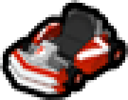
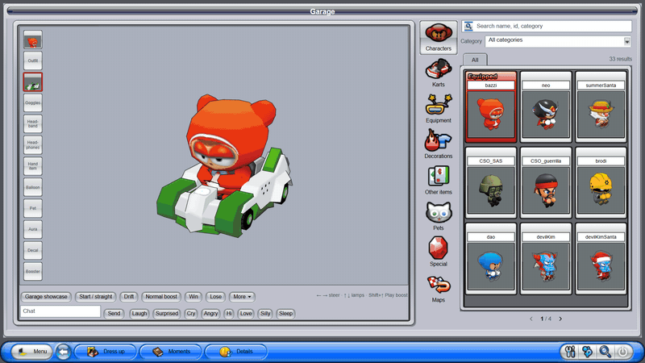
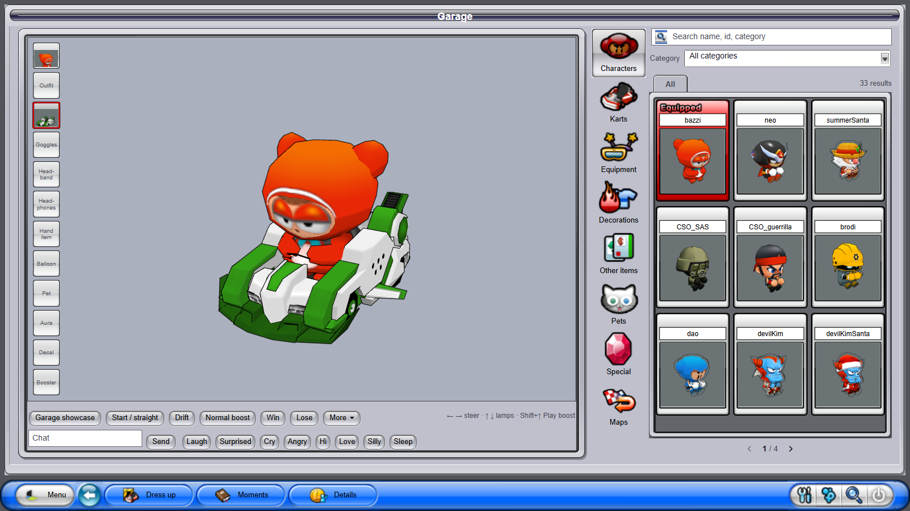
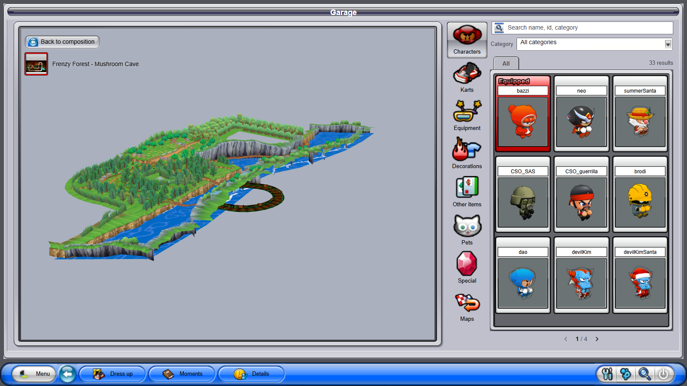

<p align="right">
  <strong>English</strong> ·
  <a href="README.zh-CN.md">简体中文</a>
</p>

<p align="center">
  <a href="https://kartarchive.com/?lang=en"></a>
</p>

<h1 align="center">Kart Archive</h1>

<p align="center">
  The art of the 2010 KartRider China client, in its original garage, in 3D, in your browser.
</p>

<p align="center">
  <a href="https://kartarchive.com/?lang=en"><strong>Open the Garage</strong></a> ·
  <a href="#features"><strong>Features</strong></a> ·
  <a href="#keys-and-chat"><strong>Keys and Chat</strong></a> ·
  <a href="#disclaimer"><strong>Disclaimer</strong></a>
</p>

<p align="center">
  <a href="https://kartarchive.com/?lang=en"></a>
  
  
  
</p>

<p align="center">
  <a href="https://kartarchive.com/?lang=en"></a>
</p>

---

Kart Archive is an unofficial fan archive of the 2010 KartRider China client: 4,900 characters, costumes, karts, accessories, effects and maps. Put a rider on a kart, dress them up, add a pet and an aura, and watch them drift, boost and celebrate the way they do in the game. It runs in the browser, with nothing to install: open [kartarchive.com](https://kartarchive.com/?lang=en).

## Features

- **The original garage** — the 2010 garage's own frames, icons, cards and buttons around a 3D stage, with a rider on a kart waiting when you arrive
- **Mix and match** — characters, costumes, karts, goggles, headbands, hand items, balloons, pets, auras and boosters, each in the spot the game puts it; a costume that hides goggles in the game hides them here too
- **Moments** — garage showcase, start, drift, boost, win and lose, played on whatever you have put together
- **Keyboard and chat** — steer, light the lamps and fire a boost with the game's own keys, and make the rider react by typing in chat
- **Maps** — every track and MyRoom opens on its own in 3D with its own animation, and 219 of them carry the card the game itself shows
- **Look closer** — double-click or double-tap any part of a model or map and the view turns around that spot; double-click empty space to go back to the starting view
- **Looks like the game** — cel-shaded outlines, thin parts visible from both sides, see-through parts layered the way the game layers them, and lamp flares that face the camera
- **Four languages** — English, Simplified Chinese, Traditional Chinese and Korean, with the game's own name for every card that has one
- **A link for every card** — any card opens straight from its own address, and the [catalog](https://kartarchive.com/catalog/) lists them all on one plain page
- **Open about what is checked** — the details panel shows how each piece was checked against the original game

<p align="center">
  
</p>

<p align="center">
  
</p>

---

## Keys and Chat

Click the stage first. These are the keys the game uses while a kart waits at the start line.

| Key | What it does |
| --- | --- |
| ← → | Turn the rider, the front wheels and the steering wheel |
| ↑ ↓ | Light the front or rear lamp flares |
| Hold Shift, / or Z, then press ↑ | Fire a one-second Play boost |
| Chat box | Type an emotion word, and the rider and the pet play that emotion once |

The numpad, IJKL and WASD work as arrows too, as they do in the game. The bar under the stage plays the other moments.

---

## Under the Hood

- **Runs in the browser** — WebGL with PlayCanvas, made for desktop browsers first; no download, no plugin
- **Loads what you open** — about 5 GB of models and textures sit in Cloudflare R2 behind one Cloudflare Worker, and each card's files arrive only when you open that card
- **Readable without JavaScript** — a plain catalog page and per-language page heads let search engines and AI answer engines read every card

More in [How kartarchive.com Is Served](docs/hosting.md).

## Offline EPUB 3 Albums

The repository includes a small, dependency-free exporter for turning a hand-picked set of local screenshots or renders into an accessible, reflowable EPUB 3 album. It adds a cover, table of contents, alt text, captions and optional links back to source cards; it does not scrape the site or include game assets.

See the [EPUB 3 album guide](docs/epub3-export.md) for the manifest format and usage:

```sh
python tools/epub3_export.py my-album/album.json --output my-album/kart-album.epub
```

---

## Takedown and Corrections

If you hold rights in any content shown on kartarchive.com or in this repository and want it removed, [open an issue](../../issues/new) titled "Takedown". List the cards (a link or an id is enough) and how we can reach you. Issues are public, so leave out anything you would not want published. We will address it promptly and reply in the issue when the content is down.

To report a wrong name, a missing item, or something that looks different from the game, [open an issue](../../issues/new) with a link to the card and what it should be.

---

## Related Project

[KartRider Tools](https://github.com/nixliuxin/KartRider-Tools) is a desktop tool that extracts KartRider assets and converts them to USD scenes.

---

## Disclaimer

Kart Archive is an unofficial fan archive. It shows game art from the 2010 China client of KartRider.

KartRider, all game assets, artwork, and related trademarks are the property of NEXON Korea Corporation, Tiancity, and/or their respective licensors and affiliates. This project is not affiliated with, endorsed by, or sponsored by any of these companies.

The archive is intended strictly for educational, research, and personal non-commercial purposes. It is provided "as is", without warranty of any kind. This repository does not include the garage website's source code or game data files. The repository includes an optional EPUB 3 packaging utility; the only game art in it is the logo, the animations and the screenshots in `docs/images`, which show what the site looks like.

---

## License

The text in this repository is licensed under [CC BY 4.0](LICENSE): you may share and adapt it, including commercially, as long as you give credit and link back to this repository.

The license does not cover game art. The logo, the animations and the screenshots in `docs/images` show KartRider artwork, which belongs to NEXON Korea Corporation, Tiancity and their licensors; this repository grants no rights to it.

Copyright © 2026 nixliuxin.

---

<p align="center">
  <sub>KartRider artwork © NEXON Korea Corporation</sub>
</p>
