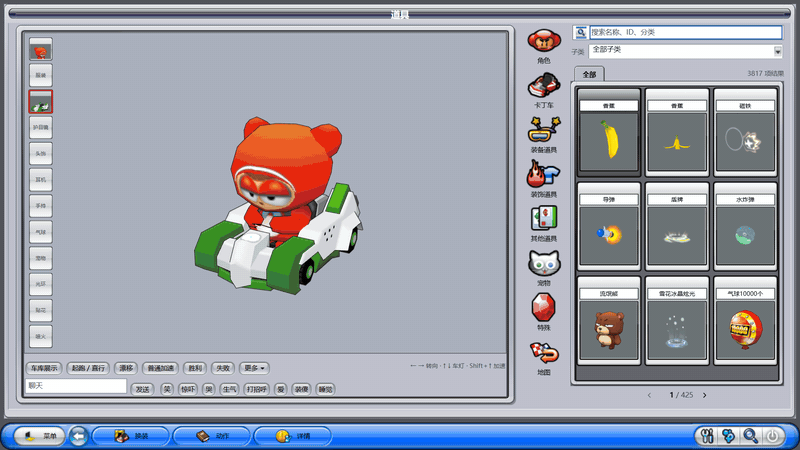
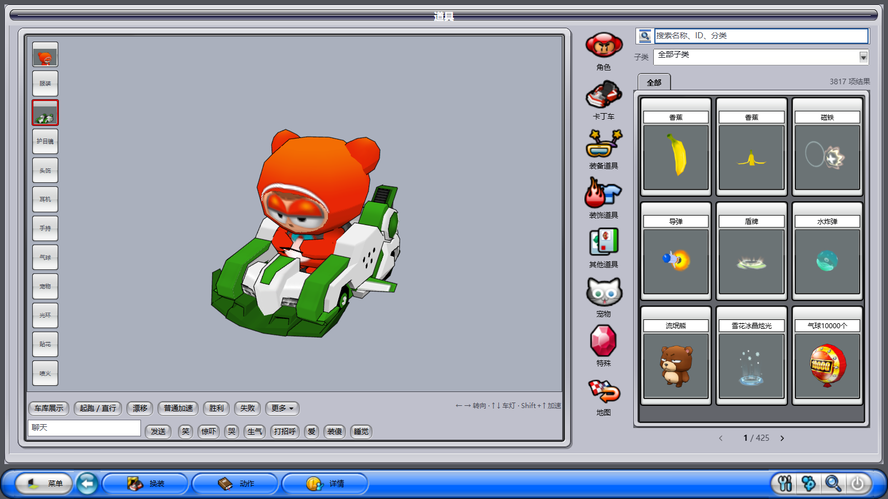
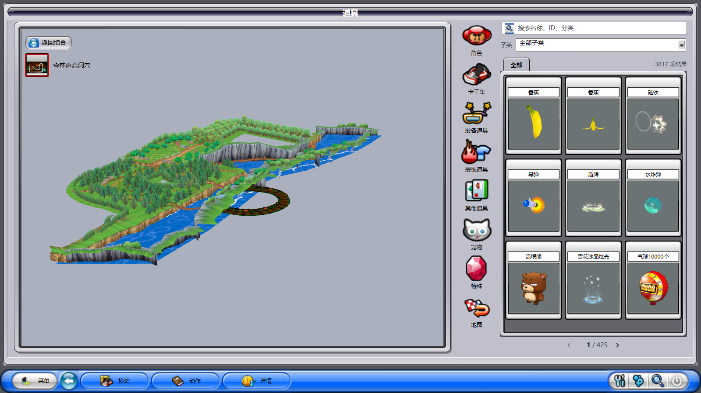

<p align="right">
  <a href="README.md">English</a> ·
  <strong>简体中文</strong>
</p>

<p align="center">
  <a href="https://kartarchive.com/"></a>
</p>

<h1 align="center">跑跑档案馆</h1>

<p align="center">
  2010 年跑跑卡丁车国服的美术资源，放回原版车库，在浏览器里以三维打开。
</p>

<p align="center">
  <a href="https://kartarchive.com/"><strong>打开车库</strong></a> ·
  <a href="#功能"><strong>功能</strong></a> ·
  <a href="#按键与聊天"><strong>按键与聊天</strong></a> ·
  <a href="#免责声明"><strong>免责声明</strong></a>
</p>

<p align="center">
  <a href="https://kartarchive.com/"></a>
  
  
  
</p>

<p align="center">
  <a href="https://kartarchive.com/"></a>
</p>

---

跑跑档案馆是一个非官方的玩家档案站，收录 2010 年跑跑卡丁车国服客户端的 4,900 件角色、服装、卡丁车、配件、特效和地图。把骑手放上车，换上服装，加上宠物和光环，看他们像在游戏里一样漂移、加速、庆祝胜利。不用下载安装，打开 [kartarchive.com](https://kartarchive.com/) 就能看。

## 功能

- **原版车库** —— 2010 年车库自己的边框、图标、卡片和按钮，围着一个三维舞台；一进来就有一个坐在车上的骑手
- **自由搭配** —— 角色、服装、车、护目镜、头饰、手持、气球、宠物、光环和喷火，都挂在游戏里的位置；游戏里会挡住护目镜的服装，这里同样挡住
- **动作** —— 车库展示、起跑、漂移、加速、胜利、失败，在你搭好的组合上播放
- **键盘和聊天** —— 用游戏原来的按键转向、开车灯、触发加速；在聊天框里打字，骑手会做出反应
- **地图** —— 每张赛道和小屋都能单件打开，带着自己的动态；其中 219 张配的是游戏自己显示的那张赛道卡图
- **凑近看** —— 在模型或地图的任意位置双击（触屏上点两下），视角就绕着那一点转；双击空白处回到初始视角
- **和游戏一个样** —— 卡通描边，薄的部件正反面都看得见，半透明部件按游戏的顺序叠在一起，车灯光晕始终朝向镜头
- **四种语言** —— 简体中文、繁体中文、英文和韩文；游戏里有名字的卡片，都用游戏自己的名字
- **每张卡片一个链接** —— 任何卡片都能从自己的网址直接打开；[目录页](https://kartarchive.com/catalog/)在一个简单页面里列出全部卡片
- **核对到哪一步都写明** —— 「详情」里能看到每件资源和原版游戏核对到了哪一步

<p align="center">
  
</p>

<p align="center">
  
</p>

---

## 按键与聊天

先点一下舞台。这些是游戏里车停在起跑线上等待出发时用的按键。

| 按键 | 作用 |
| --- | --- |
| ← → | 骑手、前轮和方向盘一起转向 |
| ↑ ↓ | 点亮前灯或尾灯光晕 |
| 按住 `Shift`、`/` 或 `Z`，再按 ↑ | 加速 1 秒 |
| 聊天框 | 发一句带表情词的话，骑手和宠物各播一次对应的表情 |

小键盘、`IJKL` 和 `WASD` 也能当方向键用，和游戏里一样。其余动作在舞台下方的「动作」栏里。

---

## 背后的技术

- **浏览器里直接跑** —— WebGL 加 PlayCanvas，以桌面浏览器为主；不用下载，不用插件
- **打开什么才加载什么** —— 约 5 GB 的模型和贴图放在 Cloudflare R2，前面只有一个 Cloudflare Workers；打开一张卡片时才取它的文件
- **不跑脚本也能读** —— 一个简单的目录页，加上按语言生成的页头，搜索引擎和大模型问答工具都能读到每张卡片

详见[跑跑档案馆是怎么托管的](docs/hosting.zh-CN.md)。

---

## EPUB 3 离线画册

本仓库附带一个无需第三方库的小工具，可把用户手动挑选的本地截图或渲染图整理成易读、可重排版式的 EPUB 3 画册。它会生成封面、目录、图片替代文本、说明文字，以及可选的原卡片链接；不会抓取网站或附带游戏资源。

清单格式和用法见 [EPUB 3 画册指南](docs/epub3-export.zh-CN.md)：

```sh
python tools/epub3_export.py my-album/album.json --output my-album/kart-album.epub
```

---

## 下架与纠错

如果你对 kartarchive.com 或本仓库展示的任何内容享有权利并希望移除，请在本仓库[开一个议题](../../issues/new)，标题写「下架」，列出要移除的卡片（给链接或编号即可）和联系方式。议题是公开的，不想公开的信息请不要写。我们会尽快处理，内容下架后在该议题里回复。

名称有误、缺了某件资源，或者看起来和游戏里不一样，也请[开一个议题](../../issues/new)，附上卡片链接和应该是什么样。

---

## 相关项目

[KartRider Tools](https://github.com/nixliuxin/KartRider-Tools) 是一个桌面工具，用来提取跑跑卡丁车的游戏资源并转换成三维场景文件。

---

## 免责声明

> 请注意：本仓库的说明以英文版为准。本中文译本仅供阅读参考；如译文与英文原版有歧义，以 [README.md](README.md) 为准。

跑跑档案馆是非官方的玩家档案站，展示的是跑跑卡丁车 2010 年国服客户端的游戏美术。

跑跑卡丁车、所有游戏资源、美术素材及相关商标均归 NEXON 韩国公司、世纪天成及／或其各自的被许可方与关联方所有。本项目与上述任何公司均无关联，未获其认可，也未受其赞助。

档案馆仅用于教育、研究及个人非商业目的，按「现状」提供，不附带任何形式的担保。本仓库不含车库网站的源代码或游戏数据文件。仓库另附一个可选的 EPUB 3 打包工具；其中唯一的游戏美术是 `docs/images` 里用来说明网站外观的图标、动图和截图。

---

## 许可

本仓库的文字以 [CC BY 4.0](LICENSE) 授权：可以转载和改写，商用也可以，但要署名并链接回本仓库。

授权不包括游戏美术。`docs/images` 里的图标、动图和截图都是跑跑卡丁车的美术，归 NEXON 韩国公司、世纪天成及其授权方所有，本仓库不授予任何权利。

版权所有 © 2026 nixliuxin。

---

<p align="center">
  <sub>跑跑卡丁车美术 © NEXON 韩国公司</sub>
</p>
